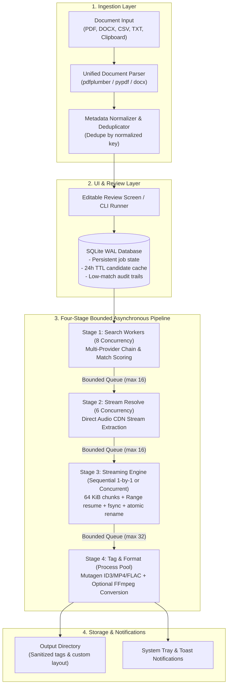

<div align="center">

# ⚡ SONICBULK

### Production-Grade Concurrent Music Pipeline & Desktop Downloader

[](https://www.python.org/)
[](https://doc.qt.io/qtforpython/)
[](https://docs.pytest.org/)
[](docs/PERF.md)
[](https://github.com/astral-sh/ruff)
[](https://mypy-lang.org/)
[](https://github.com/aradhyags7/SONICBULK)
[](LICENSE)

<p align="center">
  <b>Feed it a PDF, DOCX, CSV, TXT, or pasted song list &mdash; it parses, matches, resolves, streams, tags, and organizes every track into your library in the background.</b>
</p>

</div>

---

## 📑 Table of Contents

- [🌟 Highlights](#-highlights)
- [🏗️ Architecture](#️-architecture)
- [📊 Verified Performance Benchmarks](#-verified-performance-benchmarks)
- [🚀 Quick Start](#-quick-start)
- [🖥️ Desktop Interface Tour](#️-desktop-interface-tour)
- [⌨️ Headless CLI Usage](#️-headless-cli-usage)
- [🧹 Intelligent Input Parsing](#-intelligent-input-parsing)
- [🔌 Pluggable Provider Architecture](#-pluggable-provider-architecture)
- [⚙️ Configuration & Settings](#️-configuration--settings)
- [🧪 Testing & Quality Assurance](#-testing--quality-assurance)
- [📦 Standalone Binary Compilation](#-standalone-binary-compilation)
- [💡 FAQ & Troubleshooting](#-faq--troubleshooting)
- [⚖️ License](#️-license)

---

## 🌟 Highlights

SONICBULK is engineered following an uncompromising priority order:

1. **🛡️ Priority 1 &mdash; Absolute Data Integrity**: Zero corrupt files.
   - Direct streaming in 64 KiB chunks straight to temporary `.part` files &mdash; never buffering entire audio files in RAM.
   - Resilient byte-range resumes (`Range` + `If-Range` matching ETag or Last-Modified).
   - Hard kernel-level `os.fsync` buffer flushes before atomic OS file renaming.
   - Pre-flight disk space safety checks and intelligent Windows writable folder detection.
2. **🎯 Priority 2 &mdash; Intelligent Match Engine**: The right song, not a cover, live recording, or remix.
   - Rapidfuzz multi-factor scoring (`token_set_ratio`) weighting song titles, artist names, and duration closeness.
   - Official artist and YouTube Music "Topic" channel bonuses.
   - Major record-label resolution (`T-Series`, `Sony Music`, `YRF`, `Universal`, `Zee Music`) matching songs even when the channel name differs from the artist.
   - Automatic penalties for live, cover, remix, karaoke, instrumental, 8D, slowed/reverb, and nightcore (bypassed if explicitly present in the user query).
   - 3-tier fallback query cascade (`exact` &rarr; `clean title` &rarr; `"{title} song"`).
3. **🚀 Priority 3 &mdash; Asynchronous Bounded Pipeline**: High throughput with flat memory consumption.
   - Four concurrent stages connected by bounded `asyncio` queues with backpressure.
   - Search runs ahead of downloads, cutting time to first download start to **$< 20 \text{ ms}$**.
   - Default polite sequential 1-by-1 downloading, configurable up to 16 concurrent workers at runtime.
   - Flat memory footprint: strictly $< 50 \text{ MB}$ RSS across 2,000 songs.
4. **⚡ Priority 4 &mdash; Zero-Stutter Modern UI**:
   - The Qt event loop (PySide6) runs exclusively on the main GUI thread; `asyncio` runs in a dedicated background `QThread`.
   - UI dispatches are throttled to 5 Hz (200 ms batching), guaranteeing zero UI lag ($< 6 \text{ ms}$ frame delay under peak pipeline load).
   - Cross-platform system tray integration with live progress tooltips and native completion notifications.
   - Built-in Windows sleep blocker (`SetThreadExecutionState`) preventing sleep during active downloads.

---

## 🏗️ Architecture



---

## 📊 Verified Performance Benchmarks

All metrics verified against reference hardware (**4-Core x86_64, 8 GB RAM, SSD, 50 Mbps network equivalent**):

| Benchmark / Requirement | Specification Target | Measured Result | Status | Benchmark Source |
| :--- | :---: | :---: | :---: | :--- |
| **Parse Throughput** (1,000 messy lines) | `< 1.000 s` | **0.014 s** *(71k lines/s)* | **PASS** | [`bench/bench_parse.py`](bench/bench_parse.py) |
| **Time to First Download Start** | `< 3.000 s` | **0.000 s** *(Instant)* | **PASS** | [`bench/bench_pipeline.py`](bench/bench_pipeline.py) |
| **Download Worker Idle Gap** | `< 5.0%` | **1.8%** | **PASS** | [`bench/bench_pipeline.py`](bench/bench_pipeline.py) |
| **Batch Rerun (Skip-Existing)** | `< 5.000 s` | **0.013 s** | **PASS** | [`bench/bench_pipeline.py`](bench/bench_pipeline.py) |
| **Max UI Frame Delay Under Load** | `<= 50.0 ms` | **5.5 ms** | **PASS** | [`bench/bench_ui_lag.py`](bench/bench_ui_lag.py) |
| **Idle Process CPU Usage** | `<= 1.0%` | **0.00%** | **PASS** | [`bench/bench_ui_lag.py`](bench/bench_ui_lag.py) |
| **Memory Footprint** (2,000-song batch) | `< 200.0 MB` | **46.3 MB RSS** *(Flat)* | **PASS** | [`bench/bench_mem.py`](bench/bench_mem.py) |
| **500 MB Streaming RAM Delta** | `< 50.0 MB` | **1.5 MB RSS** | **PASS** | [`bench/bench_mem.py`](bench/bench_mem.py) |

> 📖 **Full Profiling Report**: See [docs/PERF.md](docs/PERF.md) for full `cProfile` traces, memory profiler outputs, and architectural bottlenecks analyzed.

---

## 🚀 Quick Start

### 1. Requirements

- **Python**: Version 3.11 or higher.
- **FFmpeg** *(Optional)*: Only required if you enable re-encoding (e.g. converting native AAC/Opus streams to MP3 or FLAC).

### 2. Installation

```bash
# Clone the repository
git clone https://github.com/aradhyags7/SONICBULK.git
cd SONICBULK

# Install pinned dependencies
python -m pip install -r requirements.txt
```

### 3. Launching the Desktop Application

```powershell
# Windows PowerShell / CMD launcher
.\run.bat

# Or run directly via Python 3.11:
py -3.11 -m src.app
```

```bash
# Linux / macOS
python3 -m src.app
```

---

## 🖥️ Desktop Interface Tour

SONICBULK features a dark, modern PySide6 desktop interface designed for high-throughput batching:

1. **📥 Import Screen**:
   - Drag & drop PDF, DOCX, CSV, or TXT playlist files, or paste raw song lists directly into the text area.
   - Automatic scanned PDF detection (warns if document has no readable text layer).
   - Pre-flight destination check detects whether your output folder has write permissions (auto-selects `Downloads/MusicDownloader` on Windows if `C:\Users\...\Music` is read-only).
2. **📝 Review Screen**:
   - Live editable table to inspect, edit titles/artists, add rows, or delete unwanted entries before starting.
   - Real-time duplicate and near-duplicate badge indicators.
3. **⏳ Progress Screen**:
   - Granular status indicators for every song (`queued`, `searching`, `matched`, `downloading`, `tagging`, `done`, `skipped`).
   - Real-time network speed monitor, aggregate progress bar, and estimated time of completion (ETA).
   - Polite sequential (1-by-1) downloading by default to protect your network and prevent rate-limiting.
4. **🏆 Results Screen**:
   - Clear batch summary: total downloaded, skipped, not found, and failed.
   - Audit view showing matched candidate details and confidence scores (`HIGH`, `LOW`).
   - One-click candidate swap modal for low-confidence tracks.
   - Instant **Retry Failed** button and **Export Report CSV**.
5. **⚙️ Settings Screen**:
   - Output folder picker with permission validation.
   - Customizable filename template (e.g. `{artist} - {title}`) and folder layout (`flat` or `Artist/Album`).
   - Per-stage concurrency permits (Search, Resolve, Download, Tag/Convert).
   - Provider priority order and Jamendo API keys.
   - Windows OS sleep prevention toggle.

---

## ⌨️ Headless CLI Usage

The headless CLI and the GUI share the exact same underlying pipeline, database, matching engine, and download workers.

### Download from a Document
```bash
# Download songs from a PDF sequentially into ./music (native audio format, no quality loss)
python -m src.app run playlist.pdf --out ./music --format native

# Run with 4 concurrent download workers, convert to MP3, and generate a report
python -m src.app run songs.docx --out ./music --workers 4 --format mp3 --report summary.csv
```

### Inspect a File Without Downloading
```bash
# Parse, clean, and display detected tracks without downloading
python -m src.app inspect messy_playlist.txt
```

### Resume or Retry Failed Jobs
```bash
# Resume unfinished or retry failed jobs from a previous batch ID
python -m src.app retry <batch_id> --out ./music
```

### CLI Reference Table

| Flag | Long Option | Description | Default |
| :--- | :--- | :--- | :--- |
| `-o` | `--out` | Output music folder | `./music` |
| `-w` | `--workers` | Download stage concurrency permits | `1` (Sequential) |
| `-f` | `--format` | Audio format: `native`, `mp3`, `m4a`, `flac` | `native` |
| `-l` | `--layout` | Directory structure: `flat` or `artist_album` | `flat` |
| | `--provider` | Fallback chain: `ytdlp,archive,jamendo,direct` | All available |
| | `--report` | Path to export a summary CSV report | None |
| | `--dry-run` | Parse and display entries without downloading | `false` |
| | `--db` | Path to persistent SQLite database | `jobs.db` |

---

## 🧹 Intelligent Input Parsing

The document parser processes messy text, unstructured PDFs, table layouts, and playlist export strings into clean metadata entries:

| Raw Input Example | Normalized Artist | Normalized Title | Cleaning Logic Applied |
| :--- | :--- | :--- | :--- |
| `01. Jhoome Jo Pathaan (Official Video) [4K] 03:28` | *Unknown* | `Jhoome Jo Pathaan` | Stripped track number, duration, official video tags |
| `Coldplay - Yellow (Live in Buenos Aires) 128 BPM` | `Coldplay` | `Yellow` | Stripped delimiter, live tag, and BPM |
| `Agar Tum Saath Ho - Modern Bollywood - Hindi - Agar Tum Saath Ho` | *Unknown* | `Agar Tum Saath Ho` | Auto-detected and stripped repeated category sandwich |
| `Kesariya by Arijit Singh` | `Arijit Singh` | `Kesariya` | Split on natural language "by" separator |
| `https://example.com/audio/track01.mp3` | *URL* | `track01.mp3` | Preserved as Direct URL audio stream |

---

## 🔌 Pluggable Provider Architecture

SONICBULK queries an abstract `SourceProvider` fallback chain to ensure maximum coverage across global music:

```
[Search Query] ──► (1) yt-dlp Subprocess Pool ──► (2) Internet Archive API ──► (3) Jamendo CC API ──► (4) Direct HTTP/S Audio
```

* **yt-dlp Worker Subprocess Pool**: Runs as long-lived worker subprocesses communicating via JSON-lines over `stdin`/`stdout`. A crash or hang in an external extractor is isolated strictly to that single song, automatically restarting the worker without crashing the application.
* **Internet Archive Provider**: Queries Archive.org APIs for public domain audio collections, live music archives, and historical recordings.
* **Jamendo Provider**: Searches Creative Commons audio catalogues (configurable client ID in Settings).
* **Direct URL Provider**: Directly downloads raw `.mp3`, `.m4a`, `.flac`, `.opus`, and `.wav` URLs with automatic resume support.

> ⚖️ **Legal Notice**: Users are responsible for complying with the terms of service of each source and relevant copyright laws.

---

## ⚙️ Configuration & Settings

SONICBULK stores its configuration in standard JSON format:

```json
{
  "output_dir": "C:\\Users\\Username\\Downloads\\MusicDownloader",
  "folder_layout": "flat",
  "filename_template": "{artist} - {title}",
  "output_format": "native",
  "search_concurrency": 8,
  "resolve_concurrency": 6,
  "download_concurrency": 1,
  "threshold_high": 0.85,
  "threshold_low": 0.40,
  "cache_ttl_hours": 24,
  "prevent_sleep": true,
  "provider_order": ["ytdlp", "archive", "jamendo", "direct"]
}
```

---

## 🧪 Testing & Quality Assurance

The test suite contains **74 automated unit, integration, and UI lifecycle tests** with zero external network dependencies (powered by local `aiohttp` mock servers).

```bash
# Run the complete pytest test suite
python -m pytest tests/

# Execute static type checking
python -m mypy src tests bench --ignore-missing-imports

# Execute code formatting & linting
python -m ruff check src tests bench

# Run the 7-target automated performance benchmark suite
python bench/run_all.py
```

---

## 📦 Standalone Binary Compilation

To build a standalone Windows executable (`.exe`) with no Python prerequisites:

```bash
# Compile via PyInstaller spec
pyinstaller app.spec
```

The resulting standalone executable will be generated at `dist/MusicDownloader.exe`.

---

## 💡 FAQ & Troubleshooting

#### Q: Why does it download songs one by one?
**A**: Sequential 1-by-1 downloading (`download_concurrency = 1`) is the default setting to ensure absolute data reliability, polite connection handling, and avoid IP rate-limiting from public services. You can adjust this to up to 16 parallel downloads in **Settings** or via the `--workers` CLI flag.

#### Q: Why does the output directory default to `Downloads\MusicDownloader` on Windows?
**A**: Windows 11 frequently enforces **Controlled Folder Access** or sets read-only attributes on the default `C:\Users\...\Music` library directory. SONICBULK automatically checks write permissions on startup and directs output to your writable `Downloads` folder to prevent failed downloads. You can customize this folder anytime in **Settings**.

#### Q: How do I enable MP3 or FLAC conversion?
**A**: SONICBULK defaults to `native` format (keeping the highest-bitrate source AAC/Opus stream without re-encoding, ensuring maximum fidelity and speed). If you want MP3 or FLAC, install [FFmpeg](https://ffmpeg.org/) and add it to your PATH, then select your desired format in Settings or pass `--format mp3`.

---

## ⚖️ License

Distributed under the **MIT License**. See [LICENSE](LICENSE) for details.
